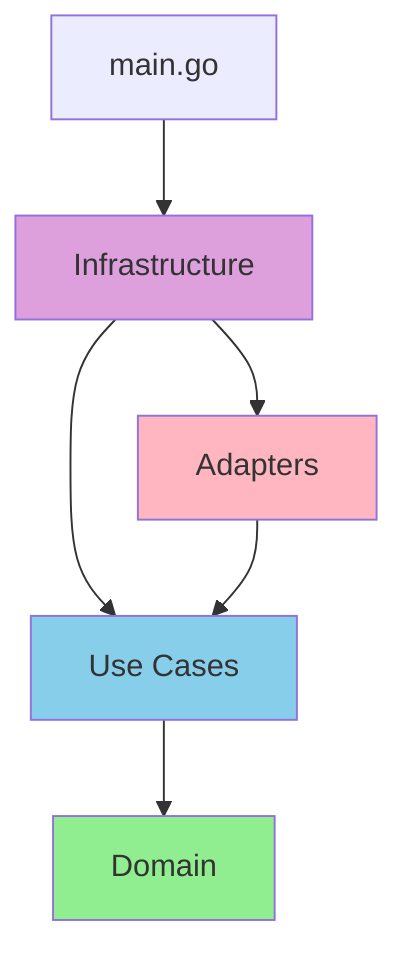
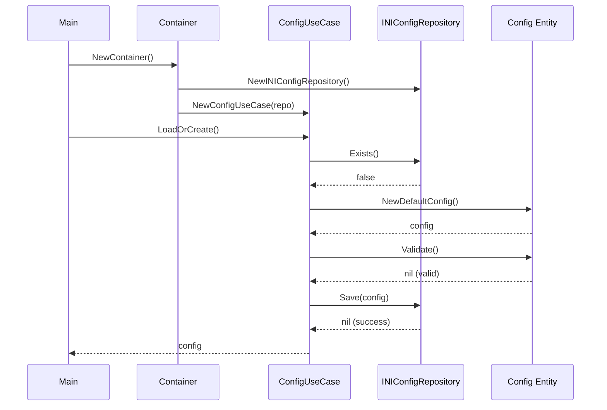

# Clean Architecture - Detailed Documentation

## Table of Contents

1. [Overview](#overview)
2. [Architecture Principles](#architecture-principles)
3. [Layer Responsibilities](#layer-responsibilities)
4. [Dependency Flow](#dependency-flow)
5. [Testing Strategy](#testing-strategy)
6. [Design Patterns](#design-patterns)

## Overview

This application implements **Clean Architecture** (also known as Hexagonal Architecture or Ports & Adapters), a software design philosophy that separates concerns into layers with strict dependency rules.

### Key Principles

1. **Independence of Frameworks**: Business logic doesn't depend on external libraries
2. **Testability**: Business logic can be tested without UI, database, or external services
3. **Independence of UI**: UI can change without affecting business logic
4. **Independence of Database**: Can swap data sources without changing business logic
5. **Independence of External Services**: Business logic doesn't know about external services

## Architecture Principles

### The Dependency Rule

**Dependencies point inward**. Source code dependencies can only point inward toward higher-level policies.

```
External → Infrastructure → Adapters → Use Cases → Domain
```

- **Domain** has no dependencies
- **Use Cases** depend only on Domain
- **Adapters** depend on Use Cases and Domain
- **Infrastructure** depends on everything but is not depended upon

### Ports and Adapters

- **Ports**: Interfaces defined in use cases (e.g., `ConfigRepository`, `ServerPort`)
- **Adapters**: Implementations in adapter layer (e.g., `INIConfigRepository`, `FiberServer`)

This allows swapping implementations without changing business logic.

## Layer Responsibilities

### 1. Domain Layer (`internal/domain/`)

**Purpose**: Core business entities and rules

**Characteristics**:
- No external dependencies
- Pure Go code
- Contains validation logic
- Represents business concepts

**Example**:
```go
// Config is a domain entity
type Config struct {
    Version string
    DevMode bool
    IP      string
    Port    int
    // ...
}

// Validate contains business rules
func (c *Config) Validate() error {
    if c.Port <= 0 || c.Port > 65535 {
        return fmt.Errorf("invalid port")
    }
    return nil
}
```

**Files**:
- `config.go`: Configuration entity with validation
- `config_test.go`: Unit tests (100% coverage)

### 2. Use Cases Layer (`internal/usecase/`)

**Purpose**: Application-specific business rules

**Characteristics**:
- Orchestrates data flow
- Defines ports (interfaces)
- Contains application logic
- Independent of frameworks

**Ports Defined**:
- `ConfigRepository`: Configuration persistence
- `Logger`: Logging abstraction
- `ServerPort`: Web server abstraction
- `WebViewPort`: WebView abstraction

**Example**:
```go
// Port (interface)
type ConfigRepository interface {
    Load(ctx context.Context) (*domain.Config, error)
    Save(ctx context.Context, config *domain.Config) error
    Exists(ctx context.Context) (bool, error)
}

// Use Case
type ConfigUseCase struct {
    repo   ConfigRepository
    logger Logger
}

func (uc *ConfigUseCase) LoadOrCreate(ctx context.Context) (*domain.Config, error) {
    // Business logic here
}
```

**Files**:
- `config_usecase.go`: Configuration management
- `server_usecase.go`: Server lifecycle
- `webview_usecase.go`: WebView lifecycle
- `*_test.go`: Unit tests with mocks (96.5% coverage)

### 3. Interface Adapters Layer (`internal/adapter/`)

**Purpose**: Convert data between use cases and external systems

**Characteristics**:
- Implements ports from use cases
- Adapts external libraries to our interfaces
- Contains no business logic
- Depends on use cases and domain

**Adapters**:

#### Repository Adapter (`adapter/repository/`)
- `INIConfigRepository`: Implements `ConfigRepository` using INI files
- Uses `gopkg.in/ini.v1` library
- Handles file I/O

#### Logger Adapter (`adapter/logger/`)
- `FileLogger`: Implements `Logger` for file logging
- `ConsoleLogger`: Implements `Logger` for console output
- Uses standard `log` package

#### Server Adapter (`adapter/server/`)
- `FiberServer`: Implements `ServerPort` using Fiber framework
- Configures middleware
- Serves static files

#### WebView Adapter (`adapter/webview/`)
- `WebViewAdapter`: Implements `WebViewPort` using webview library
- Wraps native webview functionality

**Example**:
```go
// Adapter implements port
type INIConfigRepository struct {
    filePath string
}

func (r *INIConfigRepository) Load(ctx context.Context) (*domain.Config, error) {
    // Use gopkg.in/ini.v1 to load file
    cfg, err := ini.Load(r.filePath)
    // Convert to domain.Config
    return config, nil
}
```

### 4. Infrastructure Layer (`internal/infrastructure/`)

**Purpose**: Wiring and cross-cutting concerns

**Characteristics**:
- Dependency injection
- Application initialization
- Utility functions
- No business logic

**Components**:

#### Container (`container.go`)
Dependency injection container that wires all components:

```go
func NewContainer() (*Container, error) {
    // Create filesystem utilities
    fs, _ := NewFileSystem()
    
    // Create logger
    logger, _ := logger.NewFileLogger(fs.GetSystemLogPath())
    
    // Create repositories
    configRepo := repository.NewINIConfigRepository(fs.GetConfigPath())
    
    // Create adapters
    server := server.NewFiberServer(fs.GetDistPath(), fs.GetServerLogPath())
    webview := webview.NewWebViewAdapter()
    
    // Create use cases with dependencies
    configUC := usecase.NewConfigUseCase(configRepo, logger)
    serverUC := usecase.NewServerUseCase(server, logger)
    webviewUC := usecase.NewWebViewUseCase(webview, logger)
    
    return &Container{...}
}
```

#### FileSystem (`filesystem.go`)
Utilities for path management:
- Get application path
- Get config/log paths
- File existence checks
- Directory creation

## Dependency Flow

### Compile-Time Dependencies



### Runtime Flow



## Testing Strategy

### Test-Driven Development (TDD)

All code was written following TDD:
1. Write test first (red)
2. Implement minimum code to pass (green)
3. Refactor (refactor)

### Testing Pyramid

```
        /\
       /  \  E2E Tests (Manual)
      /____\
     /      \
    / Integr \  Integration Tests
   /__________\
  /            \
 /  Unit Tests  \  Unit Tests (Automated)
/________________\
```

### Unit Tests

**Domain Layer**:
- Test all validation rules
- Test entity methods
- No mocks needed (pure functions)
- Coverage: 100%

**Use Cases Layer**:
- Test business logic
- Use mocks for ports
- Test error handling
- Coverage: 96.5%

**Adapters Layer**:
- Test adapter logic
- Use temporary files for file I/O
- Test integration with libraries
- Coverage: 88-94%

### Mock Usage

Example from `config_usecase_test.go`:

```go
type MockConfigRepository struct {
    mock.Mock
}

func (m *MockConfigRepository) Load(ctx context.Context) (*domain.Config, error) {
    args := m.Called(ctx)
    if args.Get(0) == nil {
        return nil, args.Error(1)
    }
    return args.Get(0).(*domain.Config), args.Error(1)
}

func TestConfigUseCase_LoadOrCreate_ExistingConfig(t *testing.T) {
    mockRepo := new(MockConfigRepository)
    mockLogger := new(MockLogger)
    
    expectedConfig := domain.NewDefaultConfig()
    mockRepo.On("Exists", ctx).Return(true, nil)
    mockRepo.On("Load", ctx).Return(expectedConfig, nil)
    
    uc := NewConfigUseCase(mockRepo, mockLogger)
    config, err := uc.LoadOrCreate(ctx)
    
    assert.NoError(t, err)
    assert.Equal(t, expectedConfig, config)
    mockRepo.AssertExpectations(t)
}
```

## Design Patterns

### 1. Dependency Injection

All dependencies are injected through constructors:

```go
func NewConfigUseCase(repo ConfigRepository, logger Logger) *ConfigUseCase {
    return &ConfigUseCase{
        repo:   repo,
        logger: logger,
    }
}
```

Benefits:
- Testability (can inject mocks)
- Flexibility (can swap implementations)
- Explicit dependencies

### 2. Repository Pattern

Data access abstracted behind interfaces:

```go
type ConfigRepository interface {
    Load(ctx context.Context) (*domain.Config, error)
    Save(ctx context.Context, config *domain.Config) error
}
```

Benefits:
- Can swap INI for JSON/YAML/Database
- Business logic doesn't know about storage
- Easy to test with mocks

### 3. Adapter Pattern

External libraries wrapped in adapters:

```go
type FiberServer struct {
    app *fiber.App
}

func (s *FiberServer) Start(ctx context.Context, config *domain.Config) error {
    // Wrap Fiber framework
}
```

Benefits:
- Can swap Fiber for another framework
- Business logic doesn't depend on Fiber
- Isolates framework-specific code

### 4. Factory Pattern

Container creates all objects:

```go
func NewContainer() (*Container, error) {
    // Create all dependencies
    // Wire them together
    return &Container{...}
}
```

Benefits:
- Centralized object creation
- Easy to manage dependencies
- Single place to configure app

## Benefits Realized

### 1. Testability ✅
- 90%+ test coverage
- All business logic tested in isolation
- Fast unit tests (no external dependencies)

### 2. Maintainability ✅
- Clear separation of concerns
- Easy to find and modify code
- Self-documenting structure

### 3. Flexibility ✅
- Can swap INI for JSON config
- Can replace Fiber with another framework
- Can add new features easily

### 4. Independence ✅
- Domain has zero dependencies
- Use cases don't know about frameworks
- Can test without running server/webview

## Migration from Old Architecture

### Before (Layered Architecture)
```
main.go → server → utils
       → webview → utils
```

Problems:
- Tight coupling to utils
- Global state
- Hard to test
- Framework dependencies everywhere

### After (Clean Architecture)
```
main.go → infrastructure → adapters → use cases → domain
```

Improvements:
- Loose coupling via interfaces
- No global state
- Easy to test
- Framework isolated in adapters

## Conclusion

Clean Architecture provides:
- **Testability**: 90%+ coverage with fast tests
- **Maintainability**: Clear structure and responsibilities
- **Flexibility**: Easy to swap implementations
- **Independence**: Business logic isolated from frameworks

The initial investment in structure pays off with:
- Faster development (less debugging)
- Easier refactoring (tests catch regressions)
- Better code quality (enforced separation)
- Happier developers (clear guidelines)
